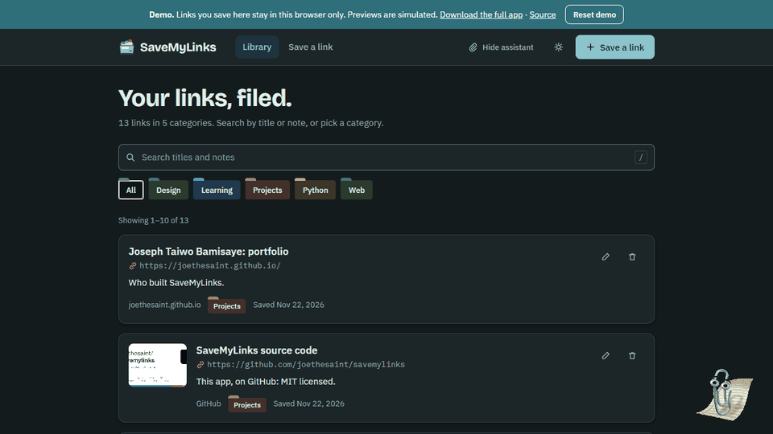
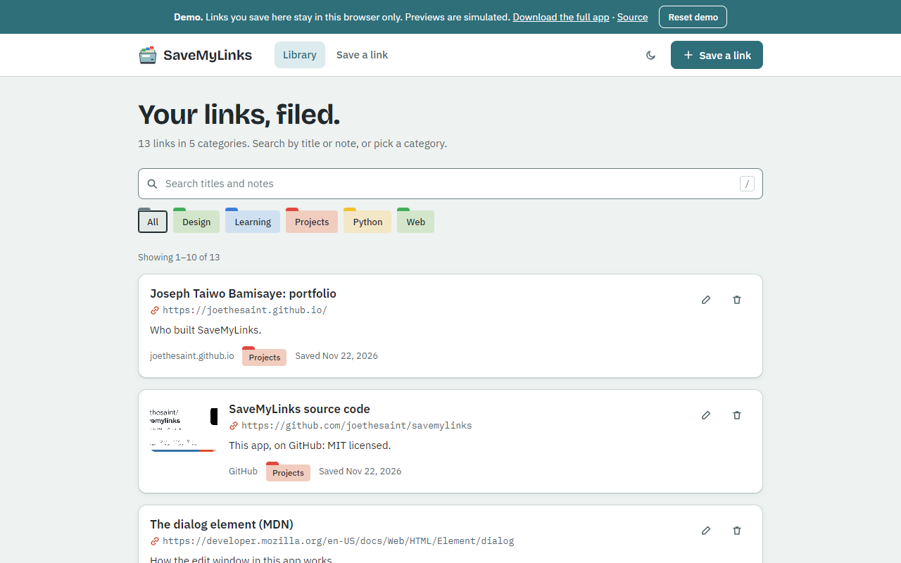
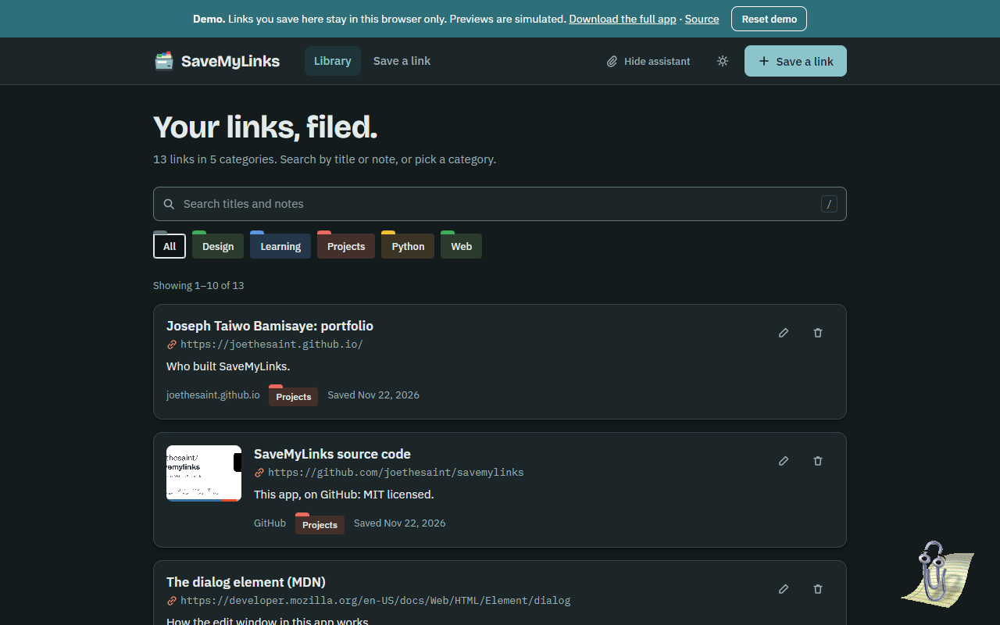
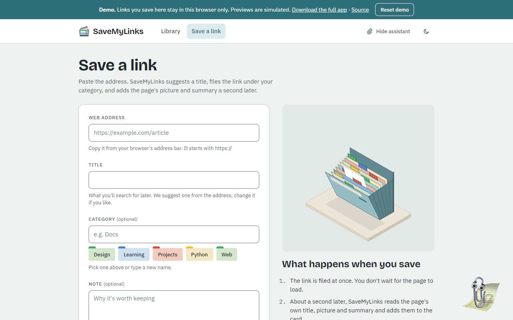
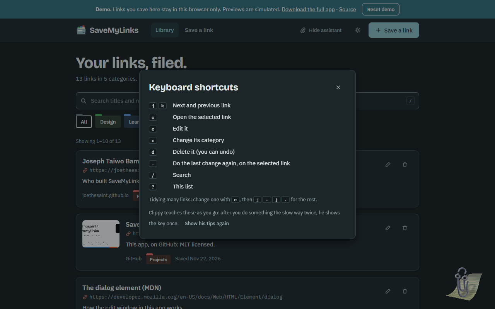
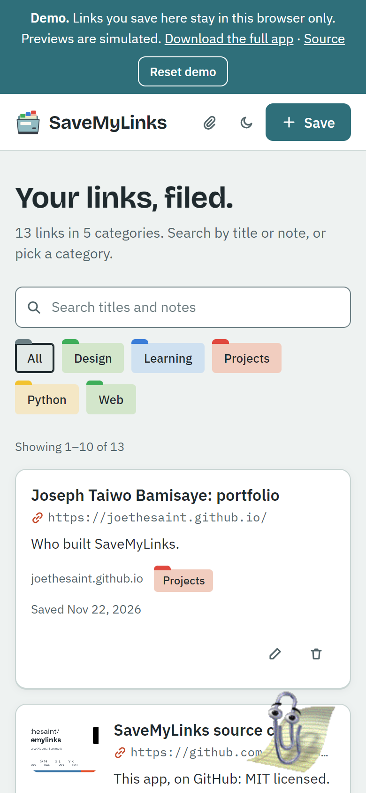
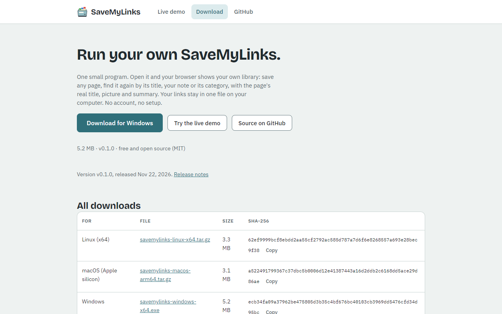

# SaveMyLinks

**Try it:** [live demo](https://joethesaint.github.io/savemylinks/) (runs in your browser; links you save stay on your device).

**Run your own copy:** get it from the [download page](https://joethesaint.github.io/savemylinks/download.html) (picks your system, shows each file's SHA-256) or from [Releases](https://github.com/joethesaint/savemylinks/releases) (Windows, macOS or Linux) and open it. Your browser opens your own SaveMyLinks with real link previews; your library is one file on your computer (`%APPDATA%\SaveMyLinks` on Windows, `~/.local/share/savemylinks` elsewhere). No Python, no setup. The browser extension works with it as-is. Built from `native/` (Rust); the Python app below is the reference it is tested against.
- **On a phone:** open the live demo and choose *Add to Home screen* / *Install app*. On Android, SaveMyLinks then appears in the *Share* menu: share any page to it and it's saved.
- Options: `--port 8123`, `--db path/to/library.db`, `--no-browser`. Export your library at `/api/export`.
- **Windows:** open `savemylinks-windows-x64.exe`. It isn't code-signed yet, so SmartScreen asks once: *More info → Run anyway*.
- **macOS / Linux:** download the `.tar.gz`, then in a terminal: `tar xzf savemylinks-*.tar.gz && ./savemylinks-macos-arm64` (or `./savemylinks-linux-x64`).
- **macOS blocked it?** Unsigned apps can be blocked outright. After the first attempt, open *System Settings → Privacy & Security* and choose *Open Anyway*, then run it again.

## See it



*Tidy links from the keyboard: `j` to select, `c` to change the category, `.` to repeat it on the next link, `d` to delete (with Undo), `?` for every key.*

| Library (light) | Library (dark) |
|---|---|
|  |  |

| Save a link | Keyboard shortcuts |
|---|---|
|  |  |

| On a phone | Download page |
|---|---|
|  |  |

Screenshots come from the [live demo](https://joethesaint.github.io/savemylinks/) with its sample links; regenerate them with `tools/screenshots.mjs` and `tools/make_gif.py`.

## How it's built

- **The app people run** is `native/` (Rust, axum, SQLite in one file). It serves the library pages and the API on
  `127.0.0.1` (port 8000 by default) and ships for Windows, macOS and Linux from [Releases](https://github.com/joethesaint/savemylinks/releases).
- **The reference app** is `app/` (Python, FastAPI). The native app is tested against it: `tests/contract` runs the same
  requests against both and checks they answer alike.
- **The browser extension** is `extension/`: one click (or Alt+Shift+S) saves the page you're on.
- **The live demo** is `demo/`: the same pages running in the browser, with links kept on your device. Every pull
  request gets its own demo while it is reviewed.
- **Reviews:** CI (tests, the API contract, builds, the demo) gates every merge; [CodeRabbit](https://coderabbit.ai)
  gives a second opinion, and [CHANGELOG.md](CHANGELOG.md) lists what it caught.
- **Traps we've hit once** are in [docs/gotchas.md](docs/gotchas.md).

## API

| Request | What it does |
|---|---|
| `GET /health` | `{"status":"healthy","service":"SaveMyLinks"}` |
| `POST /api/save` | Save a link: `{url, title?, note?, category?}`. A link already saved is updated, never duplicated. |
| `GET /api/resources` | List links: `page`, `per_page` (≤ 100), `search`, `category`, `tag` |
| `GET` / `PUT` / `DELETE /api/resources/{id}` | One link |
| `POST /api/resources/{id}/metadata` | Fetch the page's title and preview again |
| `GET /api/resources/categories`, `/facets` | Categories and tag counts |
| `GET /api/export` | The whole library as JSON |

## Develop

```bash
# Reference app (Python 3.12; the pinned packages don't build on 3.13 yet)
python -m venv venv && source venv/bin/activate   # Windows: venv\Scripts\activate
pip install -r requirements.txt
python -m uvicorn app.main:app --reload --host 127.0.0.1 --port 8000
python -m pytest

# Native app
cargo test --manifest-path native/Cargo.toml
cargo run --manifest-path native/Cargo.toml -- --no-browser
```

## Where it started

SaveMyLinks began in September 2025 as my capstone for ALX's [AI For Developers II](https://www.alxafrica.com/) course
(a FastAPI app with a Bulma front end). [reflections.md](reflections.md) is what I learned building it with AI tools.
It has since grown into the native app, the extension and the phone install above.

## License

[MIT](LICENSE) © 2025-2026 Joseph Bamisaye. Use it, change it, share it; keep the copyright notice.
